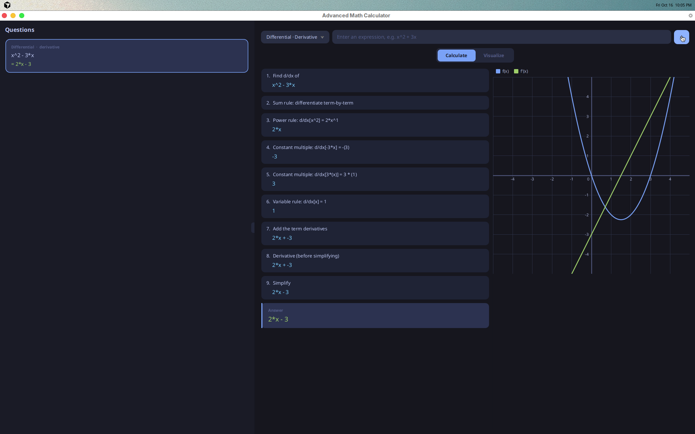

# Advanced Math Calculator

A desktop calculator for algebra, trigonometry, and introductory calculus that
shows its work. Each answer comes with a step-by-step derivation, an exact
symbolic result (with a decimal approximation where it applies), and a graph.

Expressions are parsed into a symbolic tree and manipulated exactly: numbers
are rationals, so `1/3 + 1/6` stays `1/2` rather than becoming `0.5000001`.



## Features

| Area | Operations |
| --- | --- |
| Algebra | Simplify, factor, evaluate at a point, solve linear and quadratic equations, solve polynomial inequalities |
| Functions | Domain and range, composition, inverse, transformations of a parent function |
| Trigonometry | Unit-circle values, Pythagorean identities, trigonometric equations |
| Differential calculus | Limits (factoring, conjugates, L'Hôpital's rule, one-sided, at infinity), derivatives, implicit derivatives, tangent lines |
| Integral calculus | Riemann sums, indefinite integrals of the form `a·f(bx + c)` and simple u-substitution |
| Graphing | A graph beside every result, plus a free-form graphing screen for several functions |

## Requirements

- JDK 21 or newer on your `PATH` (or `JAVA_HOME` set)

Nothing else needs installing: the Maven Wrapper downloads Maven, JavaFX, and
JUnit on first run.

## Running

```bash
./mvnw javafx:run        # macOS / Linux
mvnw.cmd javafx:run      # Windows (or double-click run.bat)
```

In VS Code or Cursor with the Java extension pack, use **Run and Debug →
Launch Calculator**. Single-file runners such as Code Runner do not work,
because the app spans several packages and needs JavaFX on the classpath.

## Testing

```bash
./mvnw test
```

## Input syntax

Expressions use `+ - * / ^`, parentheses, `pi`, `e`, and the functions `sin`,
`cos`, `tan`, `sec`, `csc`, `cot`, `sqrt`, `ln`, `log`, `exp`, and `abs`.
Implicit multiplication works (`2x`, `3(x + 1)`, `(x + 1)(x - 1)`).

| Operation | Example input |
| --- | --- |
| Evaluate | `x^2 + 1 @ x=3` |
| Solve equation | `x^2 - 5x + 6 = 0` |
| Inequality | `x^2 - 4 < 0` |
| Composition | `f(x)=x^2, g(x)=x+1` |
| Transformations | `x^2 \| 2(x-1)^2 + 3` |
| Unit circle | `30`, `45°`, `pi/6` |
| Limit | `lim x->2 (x^2-4)/(x-2)`, `lim x->1- sqrt(1-x)`, `lim x->inf (3x^2)/(x^2+1)` |
| Derivative | `x^3 sin(x)` or `d/dx(x^3 sin(x))` |
| Implicit derivative | `x^2 + y^2 = 25` |
| Tangent line | `x^2 at x=2` |
| Indefinite integral | `6 sin(2x + 1)`, `2x sin(x^2)` |
| Riemann sum | `x^2`, then enter the bounds and rectangle count |

## Project layout

```
src/main/java
├── backend
│   ├── engine     MathEngine dispatches each question to its registered MathOperation
│   ├── parser     Tokenizer, recursive-descent Parser, and the ASTNode expression tree
│   ├── models     Question, Result, Step, and the operation menu tree
│   └── math       One package per subject: algebra, functions, trig, calculus
└── ui
    ├── panels     Question history and the solution panel
    ├── components Input bars, step display, history cards
    └── visualizer Graph rendering and the free-graph screen
```

Adding an operation means implementing `MathOperation` (or `ExpressionOperation`
when the input is a single expression), registering it in `MainApp`, and adding
a menu entry.

## Known limitations

- Variables other than `x` are only supported where an operation asks for them
  (implicit derivatives use `y`; limits accept any variable name).
- Limits at infinity of radicals and compositions, such as
  `lim x->inf sqrt(x^2+1) - 2x`, are not solved yet. `LimitWorksheetTest` lists
  the known cases with their expected answers.
- Not yet implemented: definite integrals, area between curves, series and
  sequences, and linear algebra.
